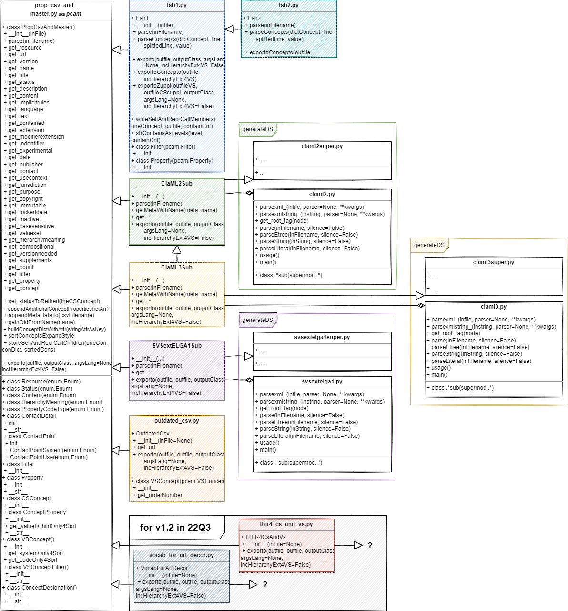

# MaLaC-CT - Markup Language Converter for Clinical Terminologies
This is the MArkup LAnguage Converter for Clinical Terminologies, short MaLaC-CT. Accepted and automaticly detected input and output classes are right now ClaML 2.0.0 with a file ending \".2.claml.xml\", ClaML 3.0.0 with a file ending \".3.claml.xml\", HL7 FHIR Shorthand 1.3.0 with a file ending \".1.fsh\", HL7 FHIR Shorthand 2.0.0 with a file ending \".2.fsh\", a predefined CSV with a file ending \".1.propcsv.csv\", a legacy CSV with a file ending \".1.outdatedcsv.csv\" and a legacy SVS with a file ending \".1.svsextelga.xml\". Additionally gofsh and sushi can be used to convert from and to a \".4.fhir.json\" or \".4.fhir.xml\", see arguments. Also, FHIR server credentials can be given, to directly convert json to xml or xml to json and to directly upload the result, see arguments.
## How to use
* malac_ct.py -i INPUT-FILE-PATH -o OUTPUT-FILE-PATH -oclass OUTPUT-CLASSIFICATION [-argsLang OUTPUT-LANGUAGE] [-sushi] [-gofsh] [j2xServer URL-TO-SERVER] [j2xUser USER-FOR-SERVER] [j2xPw PASSWORD-FOR-SERVER] [-up] [-url HOME-ADRESS-OF-RESOURCE] [-CSSupplVS] {-appndProcTermTo PROCTERM-CSV-PATH} [-incHierarchyExt4VS]
  * "-i", "--input", help='the input file, classification is detected automaticly', required=True
  * "-o", "--output", help='the output file, if none is given MaLaC-CT will convert into all other known formats.', required=False
  * "-argsLang", "--argumentLanguage", help='the language element for the output classification', required=False
  * "-sushi", "--sushiConvertingToJson", action="store_true" (if param exists, it means true/run sushi), help='Directly run sushi after MaLaC-CT. Warning: sushi has to be installed!', required=False
  * "-gofsh", "--goFshConvertingToFsh", action="store_true" (if param exists, it means true/run gpfsh), help='Directly runs gofsh before MaLaC-CT. Warning: gofsh has to be installed!', required=False
  * "-j2xServer", "--json2xmlFHIRServer", help="Directly run a json2xml convert on a given FHIR server after sushi. The FHIR Server adress including the base path wraped into quotation marks. e.g.: --user fhiruser:fhiruserpassword "http://some.url/fhir-server/api/v4/ Warning: a fhir json has to exists, that is usually generated via sushi!", required=False
  * "-j2xUser", "--json2xmlFHIRServerUser", help="the FHIR server user password if needed "FHIRServerUser" "FHIRServerPassword"", required=False
  * "-j2xPw", "--json2xmlFHIRServerUserPassword", help="the FHIR server user password if needed "FHIRServerUser" "FHIRServerPassword"", required=False
  * "-up", "--upload2FhirServer", action="store_true", help="Directly upload the converted FHIR json to the given FHIR Server. Can only be run if all the j2x argument(s) are given.", required=False
  * "-url", "--fhirIgUrl", help="the home adress of the FHIR IG Publisher URL, to fill a predefined url in the resource", required=False
  * "-CSSuppl4VS", "--CodeSystemSupplement4Valueset", action="store_true" (if param exists, it means true/create Zuppls), help="Creates a CodeSystem supplement for a ValueSet", required=False
  * "-appndProcTermTo", "--appendProcessedTerminologyTo", action='append', help="Appends the processed terminology to a given csv", required=False
  * "-incHierarchyExt4VS", "--includeHierarchyExtension4ValueSet", action='store_true' (if param exists, it means true/create hierarchies via Extensions in Valuesets), help="Includes the hierarchy extension wenn creating ValueSets", required=False
## How to expand
The easy expandability is given by descending from the prop_csv_and_master.py . All the getter, the parse and the exporto function should be implemented, to convert your new classification. Don't forget to add the new classification to the malac_ct.py argument handling!
## Class Diagramm

