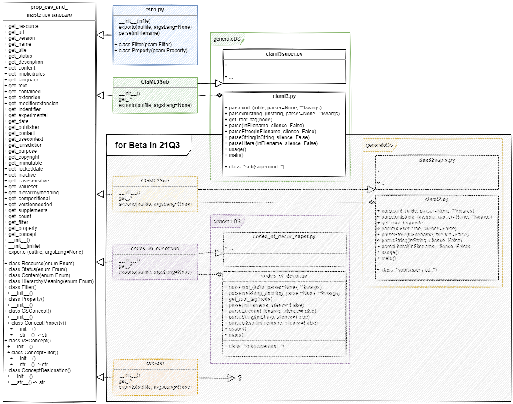

# MaLaC-CT - Markup Language Converter for Clinical Terminologies
This is the MArkup LAnguage Converter for Clinical Terminologies, short MaLaC-CT. Accepted and automaticly detected input and output classes are right now ClaML 2.0.0 with a file ending \".2.claml.xml\", ClaML 3.0.0 with a file ending \".3.claml.xml\", HL7 FHIR Shorthand 1.3.0 with a file ending \".1.fsh\", HL7 FHIR Shorthand 2.0.0 with a file ending \".2.fsh\" and a predefined CSV a file ending \".1.csv\".
## How to use
* malac_ct.py -i INPUT-FILE-PATH -o OUTPUT-FILE-PATH -oclass OUTPUT-CLASSIFICATION [-argsLang OUTPUT-LANGUAGE]
  * "-i", "--input", help='the input file, classification is detected automaticly', required=True
  * "-o", "--output", help='the output file, if none is given MaLaC-CT will convert into all other known formats.', required=False
  * "-argsLang", "--argumentLanguage", help='the language element for the output classification', required=False
## How to expand
The easy expandability is given by descending from the prop_csv_and_master.py . All the getter, the parse and the exporto function should be implemented, to convert your new classification. Don't forget to add the new classification to the malac_ct.py argument handling!
## Class Diagramm

